# Wazuh SOC Home Lab: SSH Brute-Force Detection & Automated Response

A hands-on blue-team lab using Wazuh 4.14.9, an Ubuntu endpoint, Kali Linux, and a Windows host. The project demonstrates the end-to-end workflow: collect SSH authentication events, detect repeated failures, investigate the source IP, automatically block the attacking host, and record the temporary unblock action.

> **Lab scope:** All activity was performed in an isolated VMware Host-only lab on a private `192.168.190.0/24` network against systems under my control. The SSH password-guessing simulation was deliberately limited to eight failed attempts to trigger the configured detection rule.

## Project at a glance

- **Detection:** Wazuh SSH brute-force rule `5763` (level 10).
- **Trigger condition in the installed ruleset:** eight matching SSH authentication-failure events from the same source IP within 120 seconds.
- **Response:** Wazuh Active Response invokes the built-in `firewall-drop` script on the endpoint that generated the alert.
- **Block duration:** 120 seconds.
- **Outcome:** Kali (`192.168.190.130`) was added to the Ubuntu Target's INPUT-chain DROP rule and the later `delete` action was recorded. Wazuh generated the block and unblock alerts (rules `651` and `652`).

## Lab architecture

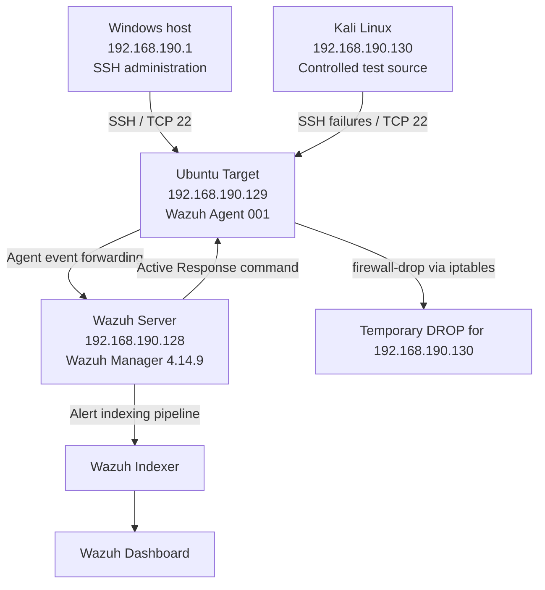

### IP and role inventory

| System | Address | Role |
|---|---:|---|
| Windows host | `192.168.190.1` | Administration and SSH client; not enrolled as a Wazuh agent in this lab |
| Wazuh Server | `192.168.190.128` | Wazuh Manager and central management services |
| Ubuntu Target | `192.168.190.129` | Monitored endpoint; Wazuh Agent ID `001` |
| Kali Linux | `192.168.190.130` | Authorized test source for SSH authentication failures |

All systems used the VMware Host-only lab network. The Windows host and Kali were explicitly allowed to connect to Ubuntu Target's SSH service before enabling UFW.

## Technologies used

- VMware Workstation virtual machines and Host-only networking
- Wazuh Manager and Agent 4.14.9; Wazuh Indexer and Dashboard (included in the stack; their individual package versions were not independently recorded)
- Ubuntu Server / Ubuntu Linux endpoint
- Kali Linux
- OpenSSH
- UFW (Uncomplicated Firewall)
- iptables (used by Wazuh's Linux `firewall-drop` response)
- Linux journald and Wazuh JSON alert logging

## Implementation and investigation

### 1. Endpoint and manager connectivity

Installed Wazuh Manager on the server and enrolled the Ubuntu Target as agent `001`. The Target's Wazuh Agent service was confirmed as `active (running)`, and the Dashboard showed the agent as Active.

### 2. Network and firewall preparation

The Ubuntu Target's UFW firewall was enabled with a default policy of denying incoming connections and allowing outgoing connections. SSH was explicitly allowed from the Windows management host and Kali test host:

```bash
sudo ufw allow from 192.168.190.1 to any port 22 proto tcp
sudo ufw allow from 192.168.190.130 to any port 22 proto tcp
sudo ufw enable
sudo ufw status verbose
```

Command notes:

- `ufw allow` creates an allow rule.
- `from <IP>` limits the source to the specified host.
- `to any port 22` selects destination TCP/UDP port 22; `proto tcp` narrows it to TCP, which SSH uses.
- `ufw enable` activates UFW. The allow rules were added first to preserve planned SSH access.
- `ufw status verbose` displays the firewall state, default policies and rules.

The firewall status screenshot shows UFW active, incoming traffic denied by default, outgoing traffic allowed, and SSH permitted from `192.168.190.1` and `192.168.190.130`.

### 3. SSH event generation and log validation

Connected from Windows and Kali to the Ubuntu Target using SSH. Ubuntu recorded successful authentication events with the remote client IP. The test then generated repeated incorrect password attempts from Kali.

The authentication evidence included entries in this form:

```text
Failed password for shekhar from 192.168.190.130 port <source-port> ssh2
```

The Ubuntu Target was using journald for the SSH event source. The same activity was collected by the Wazuh Agent and decoded by the Manager as an SSHD event. The Wazuh alert included:

- `agent.ip`: `192.168.190.129` (the monitored Ubuntu endpoint)
- `data.srcip`: `192.168.190.130` (Kali, the remote source)
- `data.dstuser`: `shekhar` (the account being targeted)
- `decoder.name`: `sshd`
- `full_log`: the failed-password event text

### 4. SSH brute-force detection

The installed Wazuh ruleset contained rule `5763` in `0095-sshd_rules.xml`. The observed rule definition included:

```xml
<rule id="5763" level="10" frequency="8" timeframe="120" ignore="60">
  <if_matched_sid>5760</if_matched_sid>
  <same_source_ip/>
  <description>sshd: brute force trying to get access to the system. Authentication failed.</description>
  <mitre>
    <id>T1110</id>
  </mitre>
</rule>
```

Interpretation of the relevant attributes:

- `id="5763"`: Rule identifier.
- `level="10"`: Wazuh alert severity level.
- `frequency="8"`: Eight matching events are required.
- `timeframe="120"`: The events must occur within 120 seconds.
- `same_source_ip`: The matching failures must share the same source IP.
- `if_matched_sid=5760`: The rule correlates the underlying SSH authentication-failure events.
- `ignore="60"`: The installed rule also includes a 60-second ignore interval after firing.
- `T1110`: MITRE ATT&CK Brute Force technique, under Credential Access.

The test generated eight failed SSH authentication events from Kali within the configured threshold. Wazuh generated rule `5763` at level 10.

### 5. Wazuh Active Response configuration

The `firewall-drop` command was already registered in the Manager configuration. The following Active Response block was enabled in the Manager's `/var/ossec/etc/ossec.conf`:

```xml
<active-response>
  <disabled>no</disabled>
  <command>firewall-drop</command>
  <location>local</location>
  <rules_id>5763</rules_id>
  <timeout>120</timeout>
</active-response>
```

Configuration meaning:

| Setting | Meaning |
|---|---|
| `disabled=no` | Enables this response |
| `command=firewall-drop` | Uses the registered firewall-drop command |
| `location=local` | Runs the response on the monitored endpoint that generated the alert |
| `rules_id=5763` | Triggers this response when rule 5763 fires |
| `timeout=120` | Reverses the temporary action after 120 seconds |

The Manager-side Active Response configuration was tested with `wazuh-execd -t`, which returned exit code `0`. The Wazuh Manager was then restarted and confirmed `active (running)`. The Ubuntu Agent's Active Response setting was also checked and showed `<disabled>no</disabled>`.

### 6. Automated block and unblock evidence

The Ubuntu Target's `/var/ossec/logs/active-responses.log` recorded the `firewall-drop` execution. The observed sequence included:

1. `firewall-drop: Starting`
2. JSON response with `"command":"add"` and the alert for rule `5763`
3. A `check_keys` message for `192.168.190.130`
4. A later JSON response with `"command":"delete"`
5. `firewall-drop: Ended`

The firewall table showed the DROP rule at the top of the INPUT chain:

```text
Chain INPUT (policy DROP)
num  target  prot  opt  source             destination
1    DROP    all   --   192.168.190.130    0.0.0.0/0
```

This confirms that the Wazuh response inserted a source-IP DROP rule for Kali. The rule was placed before the UFW chain jumps, so it took precedence over the UFW SSH allow rule for Kali while present.

The Manager's alert file and Dashboard also showed:

| Rule ID | Description | Meaning |
|---:|---|---|
| `5763` | SSH brute force trying to get access to the system | Detection alert, level 10 |
| `651` | Host Blocked by firewall-drop Active Response | Block action recorded, level 3 |
| `652` | Host Unblocked by firewall-drop Active Response | Unblock action recorded, level 3 |

The Active Response log recorded the add action at approximately 13:07:39 IST and the delete action at approximately 13:09:39 IST on 7 November 2026, matching the configured 120-second timeout. The Dashboard screenshots show the SSH detection event and the Active Response `add` and `delete` records.

### 7. Investigation workflow in the Dashboard

The alert documents were visible in the Wazuh alert index `wazuh-alerts-4.x-2026.11.07`. Useful fields for investigation were:

| Field | Observed value | Investigation use |
|---|---|---|
| `rule.id` | `5763` | Identify the brute-force detection |
| `rule.level` | `10` | Assess alert severity |
| `agent.ip` | `192.168.190.129` | Identify the monitored target |
| `data.srcip` | `192.168.190.130` | Identify the remote source |
| `data.dstuser` | `shekhar` | Identify the targeted account |
| `data.srcport` | `35864` in the triggering event | Identify the source-side port for that connection |
| `decoder.name` | `sshd` | Confirm the event decoder |
| `full_log` | Failed password from Kali | Review the original event message |

Example Dashboard searches:

```text
rule.id: 5763
```

```text
data.srcip: 192.168.190.130
```

Use a time range that includes the test window (7 November 2026, around 13:07–13:10 IST). The Dashboard's document-details panel exposes the indexed fields for investigation.

## Evidence screenshots

### Firewall configuration

**SSH allow rule for the Windows management host:**

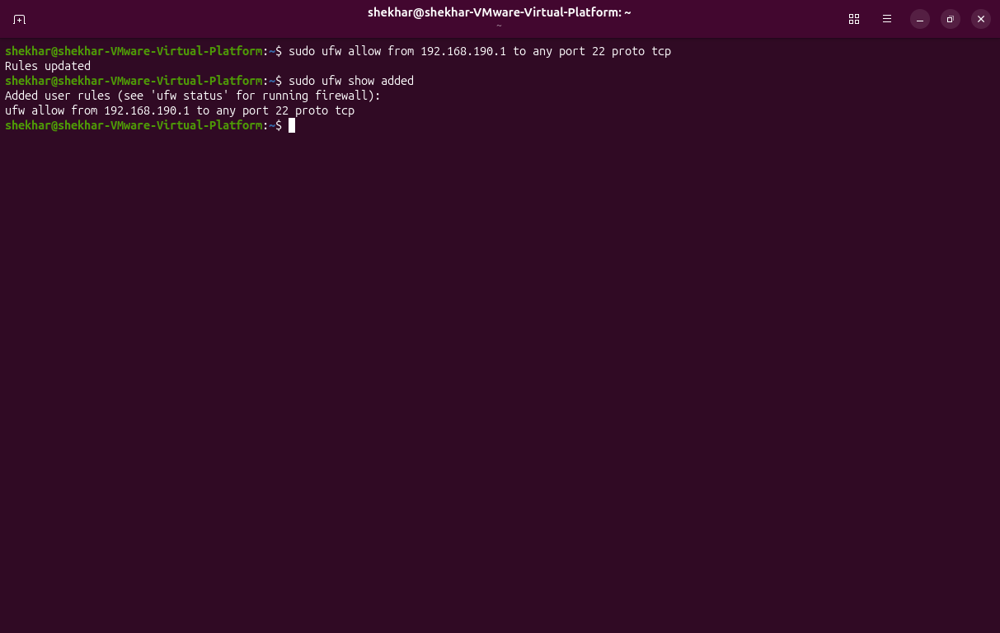

**SSH allow rules for both Windows and Kali:**

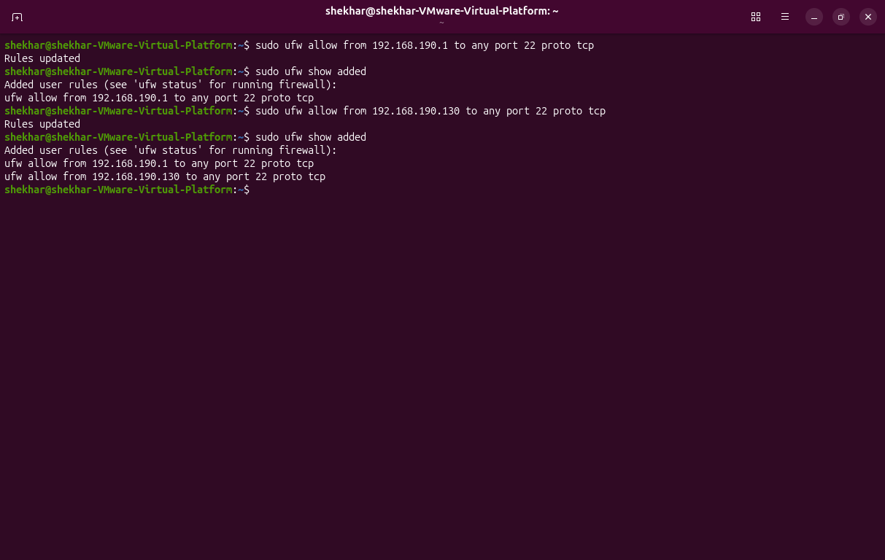

**UFW enabled with default deny incoming and explicit SSH allow rules:**

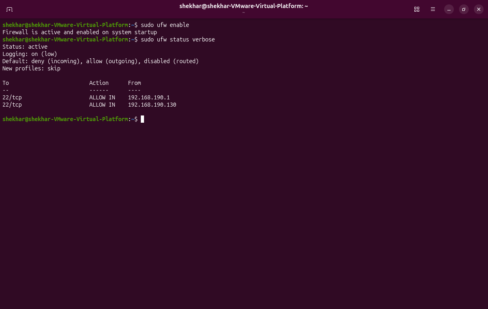

### Detection and automated response

**1. SSH brute-force detection — Rule `5763` (level 10):**

This event shows the triggering SSH failure, Kali's source IP (`192.168.190.130`), the targeted account, the previous failed attempts, and the MITRE ATT&CK technique (`T1110`).

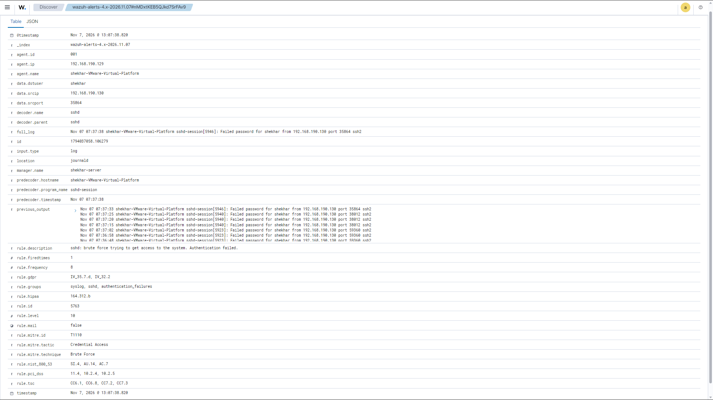

**2. Automatic blocking — Rule `651`:**

The Active Response document is split across two screenshots because the expanded event contains the original alert as nested data.

- **Part 1:** Shows `data.command = add`, the endpoint, the Active Response origin, and the source IP being blocked.
- **Part 2:** Shows the nested triggering alert (`data.parameters.alert.rule.id = 5763`) and the outer Active Response event (`rule.id = 651`).


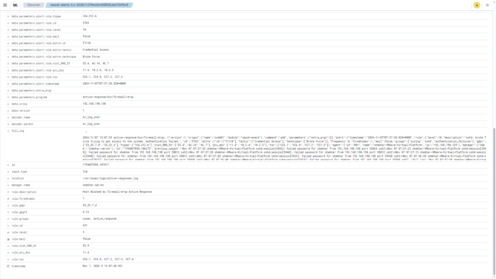

**3. Automatic unblocking — Rule `652`:**

The unblock document is also split across two screenshots for readability.

- **Part 1:** Shows `data.command = delete`, the endpoint, the Active Response origin, and the source IP being unblocked.
- **Part 2:** Shows the nested triggering alert (`data.parameters.alert.rule.id = 5763`) and the outer Active Response event (`rule.id = 652`).

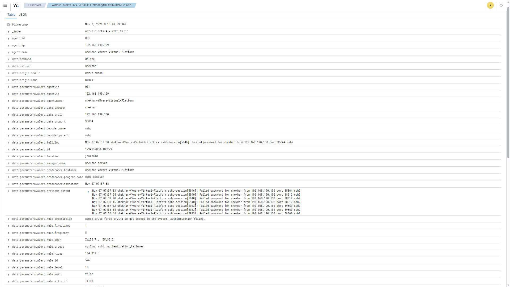

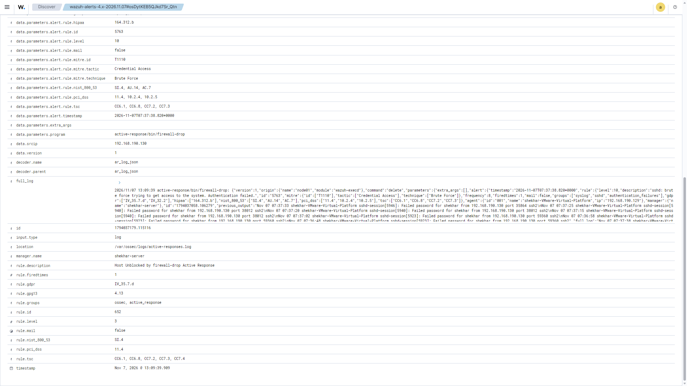

**How to read the Rule IDs:** For the block and unblock documents, the top-level `rule.id` identifies the Active Response result (`651` = blocked, `652` = unblocked). The nested `data.parameters.alert.rule.id` identifies the original detection that triggered the response (`5763`).

### Endpoint-side response verification

**iptables showing Kali's temporary DROP rule:**

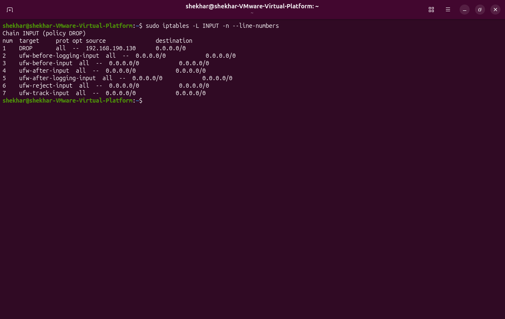

**Ubuntu Target's Active Response log showing the `add` action and its execution details:**

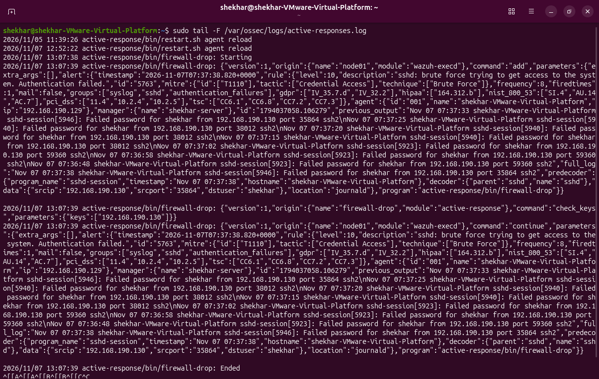

### Supplementary endpoint session evidence

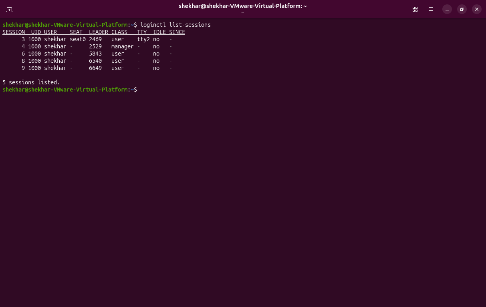

## Results

The lab successfully demonstrated the following sequence:

- Ubuntu generated SSH authentication logs for failed login attempts.
- The Wazuh Agent forwarded the collected events to the Manager.
- Wazuh rule `5763` detected eight failures from the same source IP within the configured time window.
- The Manager initiated the `firewall-drop` Active Response on the Ubuntu endpoint.
- The Ubuntu INPUT chain showed a DROP rule for Kali's IP address.
- Wazuh recorded the block event (rule `651`) and later the unblock event (rule `652`).
- The Active Response log showed the `add` and `delete` commands 120 seconds apart.

## Limitations and safety notes

- This was a controlled lab simulation, not a production penetration test.
- The Windows host was used for administration and SSH access; it was **not** enrolled as a Wazuh Agent in this project. Windows process monitoring, Sysmon collection and process-tree investigation are future extensions.
- The test covered SSH authentication failures from one source IP. It did not test distributed brute force, password spraying, DDoS, or other attack types.
- `firewall-drop` inserted an IP-wide INPUT DROP rule, not an SSH-only rule. This can block all inbound traffic from that source while active.
- UFW explicitly allowed SSH from Kali for the lab, but the higher-priority DROP rule inserted by Active Response blocked Kali while the response was active.
- The `delete` action and Wazuh unblock alert were observed. A separate post-timeout `nc` connectivity test is not included in the saved screenshots.
- Before publishing publicly, review screenshots for usernames, hostnames, private IPs, and other environment details you may prefer not to disclose.

## Skills demonstrated

- Linux SSH authentication log analysis
- Wazuh agent and manager deployment/validation
- Wazuh ruleset investigation and alert interpretation
- Source-IP and targeted-account identification
- MITRE ATT&CK mapping (`T1110`)
- UFW and iptables inspection
- Wazuh Active Response configuration
- Automated firewall blocking and timed unblock verification
- SIEM Dashboard alert investigation and evidence documentation

## References

- [Wazuh – Blocking SSH brute-force attacks with Active Response](https://documentation.wazuh.com/current/user-manual/capabilities/active-response/ar-use-cases/blocking-ssh-brute-force.html)
- [Wazuh – How to configure Active Response](https://documentation.wazuh.com/current/user-manual/capabilities/active-response/how-to-configure.html)
- [Wazuh – Active Response configuration reference](https://documentation.wazuh.com/current/user-manual/reference/ossec-conf/active-response.html)
- [Wazuh – Event logging](https://documentation.wazuh.com/current/user-manual/manager/event-logging.html)

---

**Project type:** Defensive security / SOC home lab  
**Wazuh version:** 4.14.9  
**Test date:** 6–7 November 2026
      